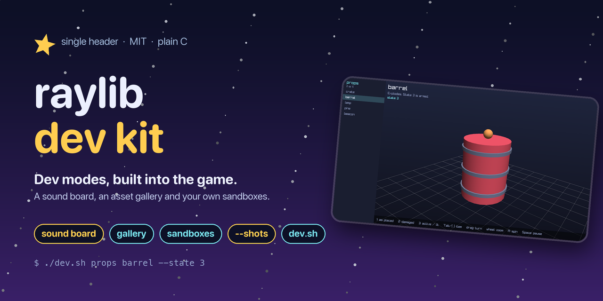
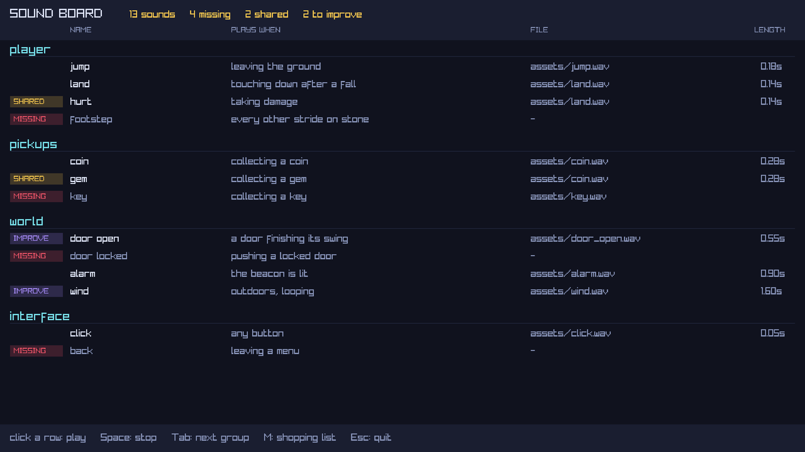
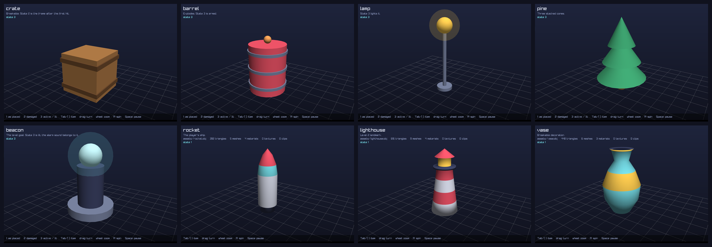

<div align="center">



# raylib dev kit

**Developer modes built into your raylib game: a sound board, an asset gallery and your own sandboxes.**

Registered in C, listed by one command, documented by the binary itself. One header.

### ▶ Try it: [sound board](https://binrick.github.io/raylib-dev-kit/?--dev&sounds) · [gallery](https://binrick.github.io/raylib-dev-kit/?--dev&props&barrel&--state&3) · [model files](https://binrick.github.io/raylib-dev-kit/?--dev&models)

[](https://github.com/binRick/raylib-dev-kit/actions/workflows/build.yml)


</div>

---

Every game grows the same side doors: a flag that opens a screen listing all the sounds, another
that shows one enemy on a pedestal, a third that drops you in an empty arena. Each gets its
own launcher script, its own hand-typed list of names, and a comment block of keys that is
out of date by Friday.

This header is those side doors, done once. You describe what the game has; it gives you the
screens, the command line, the help text and the screenshots.

```console
$ ./dev.sh
Dev modes:  ./build/game --dev <mode> [item] [--state <n>] [--shots <dir>]

  sounds     every sound, the moment that plays it, and what is still missing
      13 sounds, 7 on the shopping list
      click a row        play it
      M                  only the shopping list (missing, shared, to improve)
      ...
  props      every prop alone on a stage, in each of its states
      items: crate barrel lamp pine beacon
      1                  as placed
      2                  damaged
      3                  active / lit
      ...
  orbit      the scene with no text over it, for looking at the lighting
      left / right       faster / slower

$ ./dev.sh props zebra
unknown props item 'zebra' -- one of: crate barrel lamp pine beacon
```

That listing is printed from what the code registered. It cannot drift.

## The sound board

<div align="center">

</div>

The table has one row per **moment in the game**, not per file. That is the point: a moment
with no sound yet is a row too, and so is a moment borrowing someone else's sound.

```c
static const KitDevSound SOUNDS[] = {
    // group      name        plays when                    file                    status           note
    { "player",  "jump",     "leaving the ground",          "assets/jump.wav",      KIT_DEV_OK,      NULL },
    { "player",  "hurt",     "taking damage",               "assets/land.wav",      KIT_DEV_SHARED,  "Borrowing the landing thud." },
    { "player",  "footstep", "every other stride on stone", NULL,                   KIT_DEV_MISSING, "Walking is silent." },
    { "world",   "door",     "a door finishing its swing",  "assets/door_open.wav", KIT_DEV_IMPROVE, "Too long." },
};
kit_dev_sounds(SOUNDS, 4);
```

- Click a row to hear it. Its length is read from the file.
- **M** filters to the shopping list: everything missing, shared or marked to improve. That list is your next audio session.
- A row whose file is not on disk is marked `MISSING` automatically and logged as a warning, whatever the table claims. raylib itself stays silent about a sound that failed to load.
- Hover a row for its note.

## Galleries

<div align="center">


<sub>Made by <code>--dev props --state 3 --shots out/</code> and <code>--dev models --shots out/</code>: one PNG per item, no hands.</sub>
</div>

A gallery puts one thing on a stage, alone, with a list down the side. Two ways to fill it:

**From files.** Give each item a model path and pass `NULL` for the draw function. The kit
loads it, stands it on the floor, scales it to fit, and shows its triangle, mesh, material,
texture and animation-clip counts. Number keys play its clips.

```c
static const KitDevItem MODELS[] = {
    { "rocket",     "assets/rocket.obj",     "The player's ship." },
    { "lighthouse", "assets/lighthouse.obj", "Level 2 landmark." },
    { "anchor",     "assets/anchor.obj",     "On the list, not modelled yet." },   // shown as "not found"
};
kit_dev_gallery("models", "every model file", MODELS, 3, NULL, NULL, 0);
```

**From your own drawing code.** Pass a function and the item is whatever the game draws:
a building in its overheating state, an enemy mid-attack, a procedural tree. The number keys
set `stage->state`; what the states mean is yours to say, and your key list shows in the help.

```c
static const KitDevKey PROP_KEYS[] = { { "1", "as placed" }, { "2", "damaged" }, { "3", "active / lit" } };

static void draw_prop(const KitDevStage *stage) {       // called inside BeginMode3D, item at the origin
    draw_my_prop(stage->item, stage->state, stage->time);
}
kit_dev_gallery("props", "every prop, in each of its states", PROPS, 5, draw_prop, PROP_KEYS, 3);
```

Either way you get Tab / `[` `]` and a clickable list, drag or arrows to turn, wheel to zoom,
R to stop the spin, Space to pause, and `--shots <dir>` to save a picture of every item and
quit. That last one is your README art, your store page art, and a cheap visual regression
check: capture before a change, capture after, compare the folders.

## Your own modes

A sandbox is your code, so the kit does not run it. Register it anyway and it appears in the
listing with its keys, is checked on the command line, and can be asked for by name:

```c
static const KitDevKey ARENA_KEYS[] = { { "N", "enemies on/off" }, { "T", "fire the next trap" } };
kit_dev_custom("arena", "empty arena, you cannot be hurt", ARENA_KEYS, 2);
...
if (kit_dev_is("arena")) { god_mode = true; skip_intro = true; load_map("arena"); }
```

## Wiring it in

```c
#define KIT_DEV_IMPLEMENTATION
#include "kit_dev.h"

int main(int argc, char **argv) {
    kit_dev_sounds(SOUNDS, SOUND_COUNT);
    kit_dev_gallery("props", "...", PROPS, PROP_COUNT, draw_prop, PROP_KEYS, 3);
    kit_dev_custom("arena", "...", ARENA_KEYS, 2);
    kit_dev_init(argc, argv);            // before InitWindow: `--dev` alone prints the list and exits

    InitWindow(1280, 720, "game");
    InitAudioDevice();
    if (kit_dev_run()) {                 // a built-in mode ran instead of the game
        CloseWindow();
        return 0;
    }
    ... the game ...
}
```

On platforms that own the frame loop (browser, iOS), call `kit_dev_step()` at the top of your
frame function and return if it is true. The example does this.

Then copy [`dev.sh`](dev.sh) next to your `run.sh` and point its `BIN=` at your binary. It
builds, passes everything to `--dev`, keeps the run's output in `logs/dev-<mode>.log`, and
ends with a count of warnings and errors:

```console
$ ./dev.sh models --shots out/
WARNING: KIT_DEV: models 'anchor': assets/anchor.obj not found
[dev models] exit 0   1 warning/error lines   log: logs/dev-models.log
```

## Details

- **Help that cannot drift.** `--dev` prints modes, items and keys from the registered tables. Unknown names fail with the list of valid ones and exit code 2, before a window opens.
- **Any model lights.** The gallery's shader has a sun, a fill and ambient. A mesh with no normals falls back to face normals instead of rendering black. `kit_dev_shader()` hands it to your own draw code.
- **Screenshots at the real size.** `--shots` reads the framebuffer directly; raylib's `TakeScreenshot()` saves four times the window on a HiDPI screen.
- **Scales with the window.** The interface is laid out against the window height, so it reads the same at 720p and on a Retina display.
- **Nothing when unused.** Without `--dev`, `kit_dev_init` returns immediately and no assets are loaded.

Limits: one sound board per game; up to 16 modes, 256 sound rows and 128 items per gallery.
The gallery lighting is for reading shapes, not a preview of your game's lighting: draw with
your own shader in a draw function if you need that.

## What has been run

| | |
|---|---|
| macOS (Apple Silicon, Retina): listing, name checks, sound board, both galleries, `--shots`, `--state`, `dev.sh` | ✅ |
| Browser (Chrome): sound board plays a clicked row, gallery list click and state key, model gallery | ✅ |
| Linux and browser builds on GitHub Actions | see the build badge |
| Animated models (clips on number keys) | written against raylib 6.2's animation API, but **not exercised**: the example's models have no clips |
| Windows, iOS | not run from this repo |

## Use it with Claude Code

The repo ships an [agent skill](skills/building-raylib-dev-modes/SKILL.md) so Claude Code adds
a dev mode by registering it with the kit instead of writing another one-off flag and launcher
script, and uses `--shots` to look at assets itself.

```bash
scripts/install-skill.sh      # links it into ~/.claude/skills/
```

> *"Add a sound board to this game and tell me which moments have no sound."*

## Run the example

```bash
git clone https://github.com/binRick/raylib-dev-kit.git && cd raylib-dev-kit
./dev.sh                       # list the modes (macOS or Linux: needs cmake and a C compiler)
./dev.sh sounds
./dev.sh props barrel --state 3
scripts/build-web.sh --serve   # then open http://127.0.0.1:8080/?--dev&sounds
```

## The family

Small, separate pieces for shipping raylib games. Use one or all of them.

| | |
|---|---|
| [raylib-ship-kit](https://github.com/binRick/raylib-ship-kit) | Build and release one C codebase to macOS, Windows, Linux, browser and iOS |
| [raylib-canvas-kit](https://github.com/binRick/raylib-canvas-kit) | One fixed resolution at any window size |
| [raylib-touch-kit](https://github.com/binRick/raylib-touch-kit) | On-screen analog stick and buttons |
| [raylib-debug-kit](https://github.com/binRick/raylib-debug-kit) | JSON event log, screenshots, repeatable runs, overlay |
| **raylib-dev-kit** (this repo) | Sound board, asset gallery and sandboxes inside the game |

## License

[MIT](LICENSE). Copy `kit_dev.h` and `dev.sh` into your project.

<div align="center">

If this saved you an evening, a ⭐ helps other raylib developers find it.

</div>
